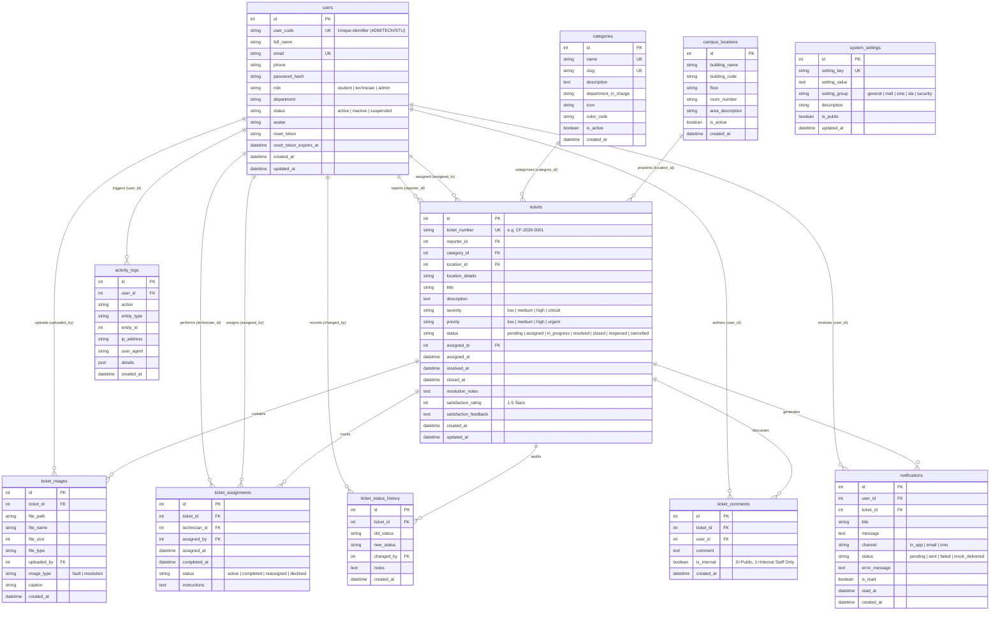

# Entity-Relationship Diagram (ERD) & Database Architecture
## CampusFix – Campus Maintenance and IT Fault Reporting & Management System

**Document Version:** 1.0.0  
**Status:** Approved for Implementation (Stage 1)  
**Database Name:** `campusfix`  
**Storage Engine:** InnoDB | **Collation:** `utf8mb4_unicode_ci`  

---

## 1. Visual Entity-Relationship Diagram (Mermaid)

The diagram below maps all eleven entities, their attributes, keys, and relational cardinalities in Third Normal Form (3NF).

---

## 2. Relational Data Dictionary

### 2.1 Table: `users`
Represents all authenticated human actors in the system.
- **`id`** (`INT UNSIGNED`, PK, Auto-Increment): Unique internal key.
- **`user_code`** (`VARCHAR(30)`, Unique, Not Null): Formatted identifier (e.g., `ADM-2026-001`, `TECH-2026-001`, `STU-2026-101`).
- **`full_name`** (`VARCHAR(100)`, Not Null): First and last name.
- **`email`** (`VARCHAR(150)`, Unique, Not Null): Academic email used for authentication and notifications.
- **`password_hash`** (`VARCHAR(255)`, Not Null): Cryptographic bcrypt hash.
- **`role`** (`ENUM('student', 'technician', 'admin')`, Not Null, Default `'student'`).
- **`status`** (`ENUM('active', 'inactive', 'suspended')`, Not Null, Default `'active'`).

### 2.2 Table: `categories`
Defines operational service domains (IT, Electrical, Plumbing, AV, etc.).
- Categorization enables automatic technician routing suggestions and departmental fault analytics.
- Features `icon` and `color_code` for consistent badge styling across frontend views.

### 2.3 Table: `campus_locations`
Normalizes campus geography into a structured entity.
- Decouples location details from free text, allowing institutional reporting on trouble spots (e.g., "Which building reports the most electrical problems?").

### 2.4 Table: `tickets`
The central transactional entity.
- **`ticket_number`** (`VARCHAR(30)`, Unique): Follows format `CF-YYYY-XXXX`.
- **`reporter_id`** (FK -> `users.id`): Student or staff member who filed the complaint.
- **`assigned_to`** (FK -> `users.id`): Field technician tasked with resolution.
- **`status`**: Current position in the resolution state machine.
- **`severity` vs `priority`**: Separates user-reported impact (`severity`) from administrative dispatch importance (`priority`).
- **`satisfaction_rating`** (`1-5`): Post-resolution student feedback metric.

### 2.5 Table: `ticket_images`
Maintains visual evidence.
- Supports initial damage photos and after-repair verification photos.
- `ON DELETE CASCADE` ensures file reference cleanup if parent ticket is purged.

### 2.6 Table: `ticket_assignments` & `ticket_status_history`
Maintains immutable audit records.
- Records exact timestamps when tickets are reassigned, diagnosed, paused, or resolved.
- Prevents disputes regarding technician response times and SLA metrics.

### 2.7 Table: `ticket_comments`
Chronological discussion log.
- Supports public messaging and private internal technician discussions (`is_internal = 1`).

### 2.8 Table: `notifications` & `activity_logs`
- **`notifications`**: Drives the in-app notification bell and external mail/SMS dispatchers.
- **`activity_logs`**: Security compliance ledger recording IP addresses, user agents, and serialized JSON event payloads.

---

## 3. Database Normalization (3NF) Justification

1. **First Normal Form (1NF):**
   - All columns contain atomic, indivisible values.
   - Repeating groups (such as multiple photos, multiple status updates, and multiple comments) are isolated into dedicated child tables (`ticket_images`, `ticket_status_history`, `ticket_comments`).
2. **Second Normal Form (2NF):**
   - All tables possess a designated primary key.
   - Every non-key column is fully functionally dependent on the entire primary key, eliminating partial dependencies.
3. **Third Normal Form (3NF):**
   - Transitive dependencies are removed.
   - Categories and Campus Locations are separated into their own normalized tables rather than duplicating building names and category descriptions across thousands of ticket rows.

---

## 4. Indexing & Query Optimization Strategy

| Index Name | Table | Indexed Columns | Query Purpose |
| :--- | :--- | :--- | :--- |
| `idx_tickets_status` | `tickets` | `(status)` | Accelerates dashboard filtering by active state (`pending`, `in_progress`). |
| `idx_tickets_reporter` | `tickets` | `(reporter_id)` | Optimizes Student "My Reports" query. |
| `idx_tickets_assigned_to` | `tickets` | `(assigned_to)` | Speeds up Technician "My Assigned Jobs" dashboard. |
| `idx_tickets_category_loc` | `tickets` | `(category_id, location_id)` | Powers admin recurring problems analytics. |
| `idx_notifications_user_read` | `notifications` | `(user_id, is_read)` | Instant lookup for topbar unread alert badge counter. |
| `idx_activity_created_at` | `activity_logs` | `(created_at)` | Fast chronological security audit queries. |

---

## 5. Referential Integrity & Cascade Rules

- **`tickets.reporter_id`**: `ON DELETE RESTRICT` — Preserves historical record of tickets even if a student account is deactivated.
- **`tickets.assigned_to`**: `ON DELETE SET NULL` — Prevents orphan tickets if a technician profile is retired.
- **`ticket_images.ticket_id`**: `ON DELETE CASCADE` — Automatically removes orphaned image references when a test ticket is removed.
- **`ticket_status_history.ticket_id`**: `ON DELETE CASCADE` — Maintains tight coupling with parent ticket lifecycle.
