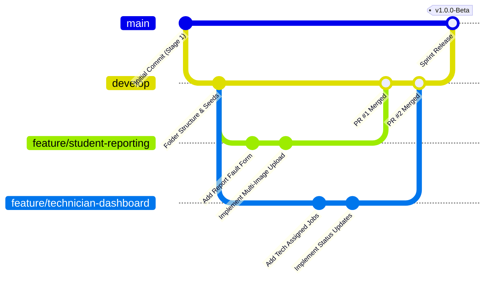

# Team Collaboration & GitHub Workflow Guide
## CampusFix – Campus Maintenance and IT Fault Reporting & Management System

**Document Version:** 1.0.0  
**Target Audience:** 5 University Engineering Group Team Members  
**Framework:** GitHub Flow / Feature Branch Strategy  

---

## 1. 5-Member Team Role & Module Allocation

To ensure seamless progress without code collisions, each team member is assigned primary ownership of a distinct vertical slice of the CampusFix architecture.

```
+----------------------------------------------------------------------------------------+
|                             CAMPUSFIX TEAM ORGANIZATION                                |
+----------------------------------------------------------------------------------------+
| Member 1: Project Lead / Architecture, Database & Security Specialist                  |
| Member 2: UI/UX & Frontend Design System Specialist                                    |
| Member 3: Student Module & Media Upload Specialist                                     |
| Member 4: Technician Module & Workflow Specialist                                      |
| Member 5: Admin Management, Analytics & Notification Specialist                         |
+----------------------------------------------------------------------------------------+
```

### Member 1: Project Lead / Architecture, Database & Security Specialist
- **Core Ownership:**
  - Database schema integrity, migrations, and `database/campusfix.sql`.
  - Core database connection wrapper (`app/config/database.php`) using PDO.
  - Security infrastructure: Session handling, CSRF token middleware, and RBAC gatekeeper (`AuthMiddleware.php`).
  - Base routing and bootstrap loader (`index.php`).
  - Repository coordination, pull request reviews, and sprint management.

### Member 2: UI/UX & Frontend Design System Specialist
- **Core Ownership:**
  - Global responsive layout templates (`views/layouts/header.php`, `footer.php`, `sidebar.php`, `navbar.php`).
  - Design system styling (`assets/css/style.css`, `dashboard.css`, `auth.css`) using Navy/Royal Blue palette.
  - Frontend interactive enhancements (`assets/js/main.js`): Dynamic form validation, toast notifications, confirmation modals, and empty state illustrations.
  - Authentication views (`views/auth/login.php`, `views/auth/register.php`, `views/auth/forgot-password.php`).

### Member 3: Student Module & Media Upload Specialist
- **Core Ownership:**
  - Student portal controller and views (`app/controllers/StudentController.php`, `views/student/*`).
  - Fault reporting form with dynamic building/floor/room cascading selectors.
  - File upload engine (`app/services/UploadService.php`): Secure multi-image upload, MIME checking, and thumbnail generation.
  - Student ticket tracking dashboard, chronological status progress tracker, and resolution confirmation/rating modal.

### Member 4: Technician Module & Workflow Specialist
- **Core Ownership:**
  - Technician controller and views (`app/controllers/TechnicianController.php`, `views/technician/*`).
  - Assigned work order dashboard with multi-criteria filtering (Status, Priority, Building, Category).
  - Ticket detail & investigation view: Visual evidence inspector, user contact information.
  - Work execution flow: Status transition from `Assigned` -> `In Progress` -> `Resolved`.
  - Technician resolution modal: Repair documentation, time spent, parts used, and after-repair photo upload.

### Member 5: Admin Management, Analytics & Notification Specialist
- **Core Ownership:**
  - Administrator controller and views (`app/controllers/AdminController.php`, `views/admin/*`).
  - Master ticket triage desk: Manual technician dispatch, priority escalation, ticket reassignment.
  - Interactive analytics dashboard using Chart.js (`assets/js/charts.js`): Category distribution, campus building heatmaps, technician workload, MTTR.
  - Notification engine (`app/services/NotificationService.php`, `SmsService.php`): In-app alert bell, PHPMailer SMTP email dispatch, and resilient Mock SMS provider.
  - System settings and catalog management (Categories, Campus Locations, Users).

---

## 2. GitHub Branching Strategy (Git Flow)

To protect the codebase and facilitate concurrent development, the team will adhere to the following branching model:



### Branch Conventions
1. **`main` (Production Branch):**
   - Strictly protected. Contains only fully tested, milestone-ready releases.
   - Direct commits are forbidden. Only merges from `develop` via Pull Request.
2. **`develop` (Integration Branch):**
   - Day-to-day shared collaboration branch. All completed features are merged here.
3. **`feature/<name>` (Feature Branches):**
   - Branched off `develop`. Used by individual members to build assigned features.
   - Examples:
     - `feature/auth-and-rbac` (Member 1)
     - `feature/saas-design-system` (Member 2)
     - `feature/student-fault-reporting` (Member 3)
     - `feature/technician-work-queue` (Member 4)
     - `feature/admin-analytics-and-alerts` (Member 5)
4. **`bugfix/<issue-description>`:**
   - Used to address bugs discovered during testing on `develop`.

---

## 3. Commit Message Standards (Conventional Commits)

All team members must write descriptive commit messages following the Conventional Commits specification:

| Prefix | Description | Example |
| :--- | :--- | :--- |
| `feat:` | A newly implemented feature | `feat(student): add dynamic room dropdowns in fault form` |
| `fix:` | A resolved bug | `fix(auth): fix password reset token expiry check` |
| `docs:` | Documentation updates | `docs(erd): update cardinality for ticket status history` |
| `style:` | CSS or UI layout tweaks | `style(dashboard): refine badge color for urgent severity` |
| `refactor:` | Code restructuring without behavior change | `refactor(db): extract query helper into Database.php` |
| `test:` | Adding unit or manual test cases | `test(upload): add invalid MIME type upload test case` |

---

## 4. Pull Request & Code Review Protocol

To prevent breaking changes:
1. **Open Pull Request (PR):** Target `develop` as the base branch from your `feature/*` branch.
2. **PR Description Checklist:**
   - Summary of changes implemented.
   - Which user role and views are affected.
   - Manual testing steps executed.
   - Confirmation that no plain text passwords or secrets are committed.
3. **Review Requirement:** At least **one peer review** approval is required before merging. Member 1 (Project Lead) coordinates major integrations.
4. **Merge Method:** Use **"Squash and Merge"** or **"Rebase and Merge"** to maintain a clean linear history on `develop`.

---

## 5. Merge Conflict Prevention & Resolution

### Prevention Best Practices
- **Pull Frequently:** Run `git checkout develop && git pull origin develop` before starting work every day.
- **Rebase Feature Branch:** Run `git checkout feature/your-feature && git rebase develop` to keep your branch up-to-date with colleagues' merged work.
- **Separate Files:** Never edit another member's assigned controller or view without prior communication in the group chat.

### Conflict Resolution Steps
If Git signals a conflict during a rebase or merge:
```bash
# 1. Inspect conflicted files
git status

# 2. Open conflicted files in VS Code / IDE and choose 'Accept Incoming' or 'Accept Current'
# 3. Mark resolved files
git add <resolved-file-path>

# 4. Continue rebase
git rebase --continue

# 5. Push updated feature branch
git push origin feature/your-feature --force-with-lease
```
