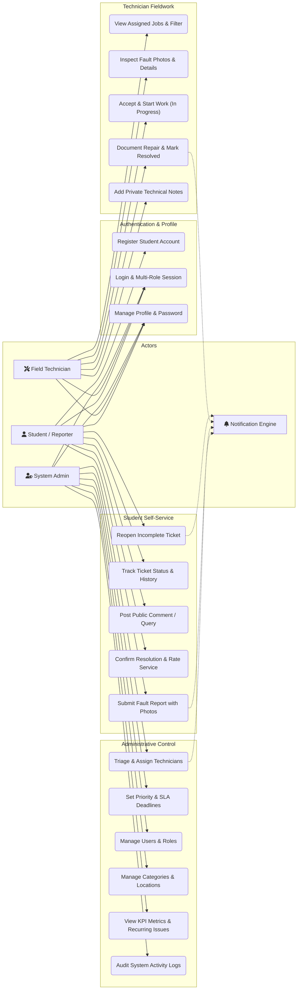
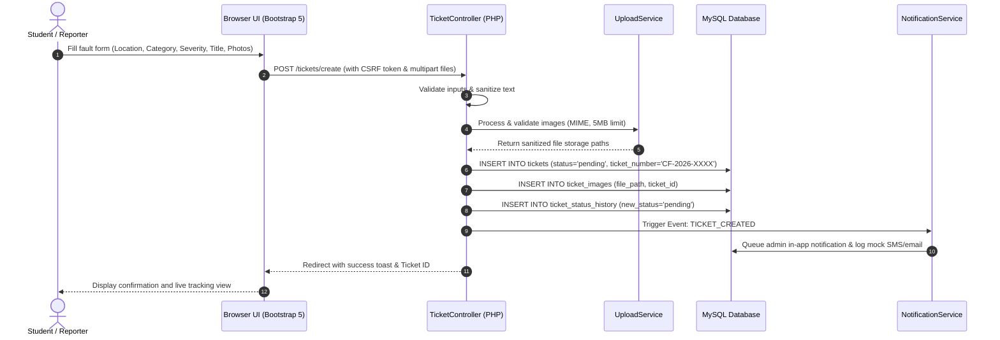
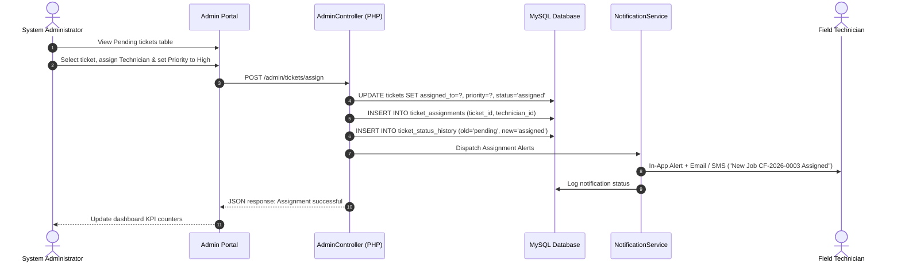
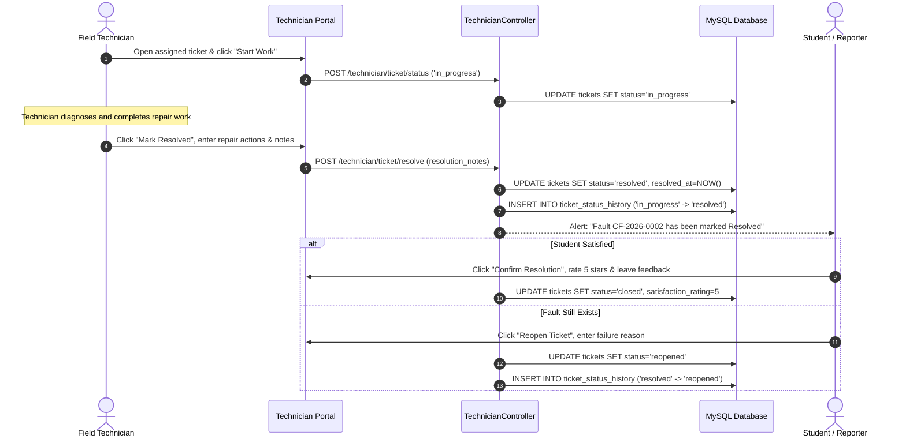

# Use Case Diagrams & Behavioral Specifications
## CampusFix – Campus Maintenance and IT Fault Reporting & Management System

**Document Version:** 1.0.0  
**Status:** Approved for Implementation (Stage 1)  

---

## 1. System Actors

| Actor | Type | Description |
| :--- | :--- | :--- |
| **Student / Campus Reporter** | Human (Primary) | University student, faculty member, or staff reporting maintenance or IT breakdowns. |
| **Field Technician** | Human (Primary) | University maintenance artisan or IT engineer assigned to diagnose and resolve faults. |
| **System Administrator** | Human (Primary) | Facilities supervisor or IT helpdesk manager with full operational oversight and dispatch privileges. |
| **Notification Engine** | Automated (Secondary) | Background service dispatching in-app alerts, SMTP emails, and SMS messages. |

---

## 2. High-Level System Use Case Diagram

---

## 3. Core Behavioral Sequence Diagrams

### 3.1 Sequence 1: Fault Submission & Automatic Triage Notification

### 3.2 Sequence 2: Administrative Triage & Technician Dispatch

### 3.3 Sequence 3: Repair Execution, Resolution & Student Feedback Loop

---

## 4. Granular Use Case Narratives

### UC-01: Submit Fault Report
- **Primary Actor:** Student / Campus Reporter
- **Preconditions:** User must be logged in with an active account.
- **Trigger:** User navigates to `/student/report-fault`.
- **Main Flow:**
  1. System displays category options, campus location dropdowns (Building, Floor, Room), severity radio buttons, title, and description fields.
  2. User selects Category (e.g., "Electrical & Power Outlets").
  3. User selects Location (e.g., "Balme Central Library > Ground Floor > Reading Hall A").
  4. User enters Title: "Sparks from power outlet on column 4".
  5. User attaches 2 JPG photos of the damaged outlet.
  6. User clicks "Submit Report".
  7. System validates fields, inspects image MIME types, creates ticket ID `CF-2026-0003`, saves records, and dispatches admin alerts.
  8. System redirects user to the ticket tracking view with a success notification.
- **Alternate Flows:**
  - *Image exceeds 5MB or invalid format:* System displays inline validation warning and preserves form input.
- **Postconditions:** Ticket is recorded in the database with status `pending`.

### UC-02: Document Repair & Mark Resolved
- **Primary Actor:** Field Technician
- **Preconditions:** Technician is authenticated; ticket is currently assigned to them.
- **Trigger:** Technician selects "Mark Resolved" modal from their workspace.
- **Main Flow:**
  1. Technician opens the ticket detail modal.
  2. Technician enters technical resolution notes (e.g., "Replaced burned socket base with 13A dual switched unit; tested voltage at 230V").
  3. Technician optionally uploads an after-fix photo.
  4. Technician submits resolution form.
  5. System records `resolved_at` timestamp, changes ticket state to `resolved`, updates `ticket_status_history`, and alerts the student reporter.
- **Postconditions:** Ticket enters `resolved` state awaiting user closure or reopening.

### UC-03: View Analytics & Recurring Issues
- **Primary Actor:** System Administrator
- **Preconditions:** Admin is logged in.
- **Main Flow:**
  1. Admin opens `/admin/analytics`.
  2. System queries aggregate tables:
     - Top fault categories (Chart.js doughnut chart).
     - Fault frequency by campus building (Chart.js bar chart).
     - Average turnaround time (MTTR in hours).
     - Technician workload distribution (Assigned vs Completed).
     - Overdue SLA incidents.
  3. Admin filters analytics by date range (Past 7 days, 30 days, or Semester).
- **Postconditions:** Facilities management gains clear operational visibility for preventative maintenance planning.
