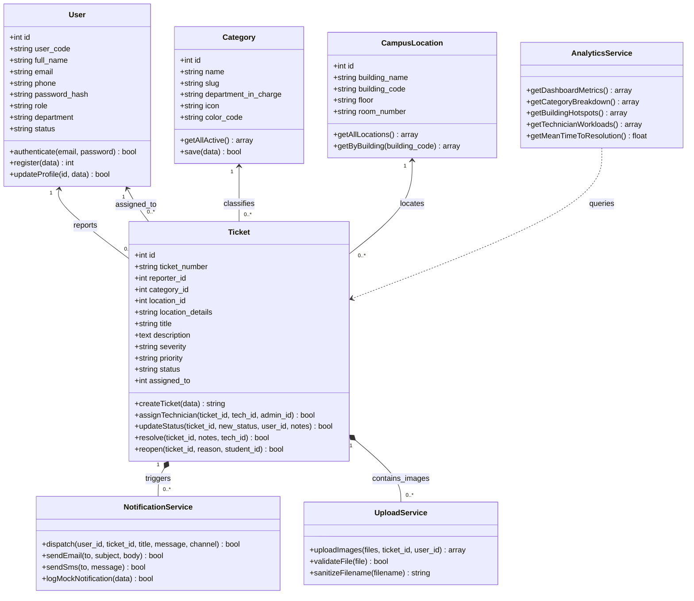
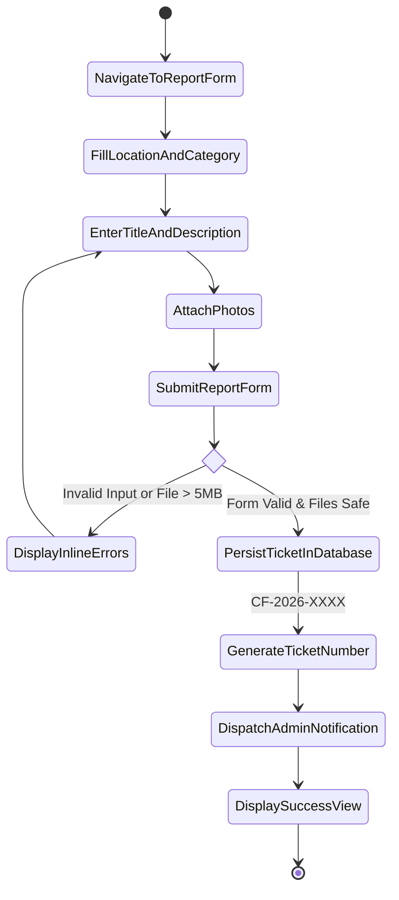
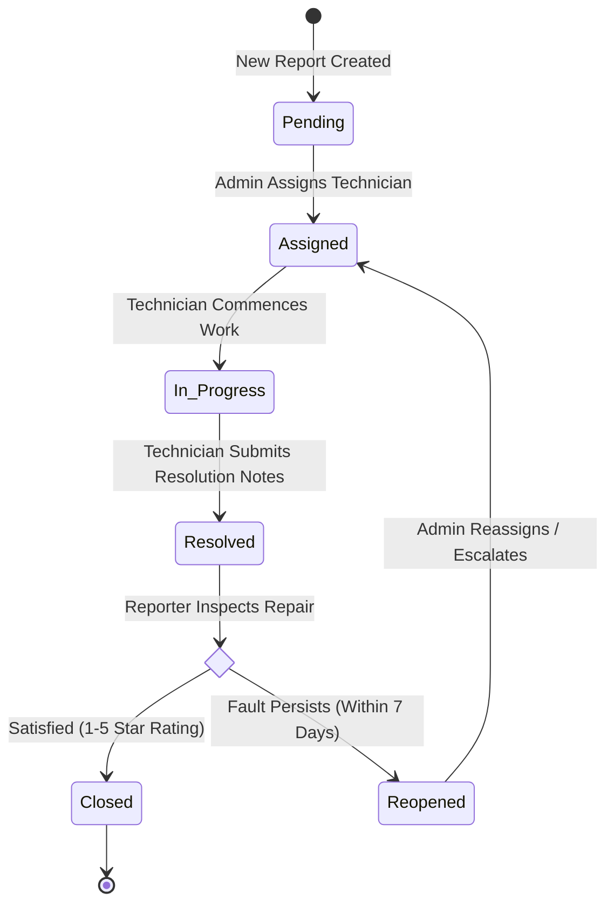

# System Architecture & Technical Diagrams
## CampusFix – Campus Maintenance and IT Fault Reporting & Management System

**Document Version:** 1.0.0  
**Status:** Approved for Implementation (Stage 1)  

---

## 1. Multi-Tier Application Architecture

CampusFix utilizes a modern, modular 3-Tier Web Application Architecture designed for maintainability, security, and clean separation of concerns.

```
+-------------------------------------------------------------------------+
|                         PRESENTATION TIER (CLIENT)                      |
|  - HTML5 / CSS3 / JavaScript (ES6+)                                     |
|  - Bootstrap 5.3 Framework & Responsive Grid                            |
|  - Chart.js Analytics Visualizations                                    |
|  - Bootstrap Icons & SaaS UI Design Tokens                              |
+-------------------------------------------------------------------------+
                                    |
                                    | HTTPS / HTTP (RESTful & Form POST)
                                    v
+-------------------------------------------------------------------------+
|                         APPLICATION TIER (SERVER)                       |
|  - Web Server: Apache 2.4 (VirtualHost / mod_rewrite)                   |
|  - Runtime: PHP 8.0+                                                    |
|  - Routing & Middleware: AuthMiddleware, CsrfMiddleware, RBAC Guard     |
|  - Controllers: Auth, Student, Technician, Admin, Tickets               |
|  - Services: NotificationService, UploadService, SmsService             |
|  - Helpers: Security, Formatting, Mailer (PHPMailer SMTP)               |
+-------------------------------------------------------------------------+
                                    |
                                    | PDO (Prepared Statements & Pool)
                                    v
+-------------------------------------------------------------------------+
|                            DATA TIER (STORAGE)                          |
|  - RDBMS: MySQL 8.0+ / MariaDB 10.4+ (InnoDB Engine)                    |
|  - 11 Normalized Tables in 3NF (Transactions, Audit Logs, Settings)    |
|  - File System: Secure Uploads Repository (/uploads/tickets, /avatars)  |
+-------------------------------------------------------------------------+
```

---

## 2. Object-Oriented Class Diagram

The following Mermaid class diagram illustrates the primary entity models, controllers, and service providers powering CampusFix.



---

## 3. System Activity Diagrams

### 3.1 Student Fault Reporting Activity


### 3.2 Ticket Triage & Resolution Activity


